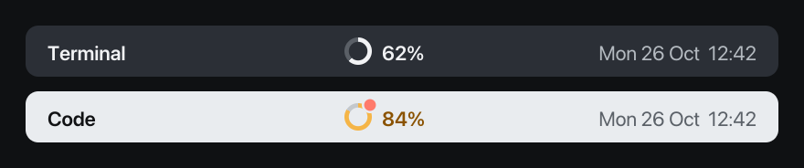
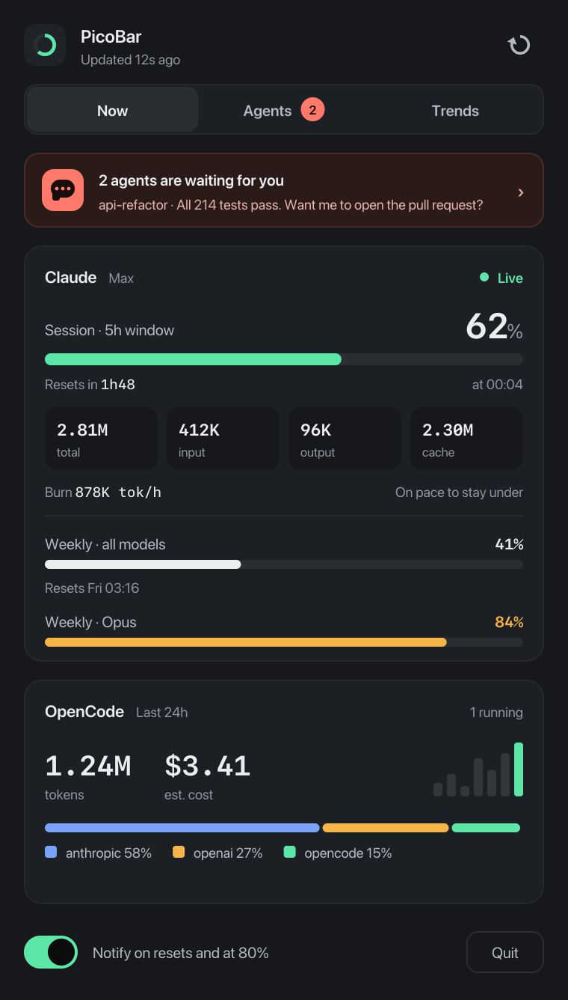
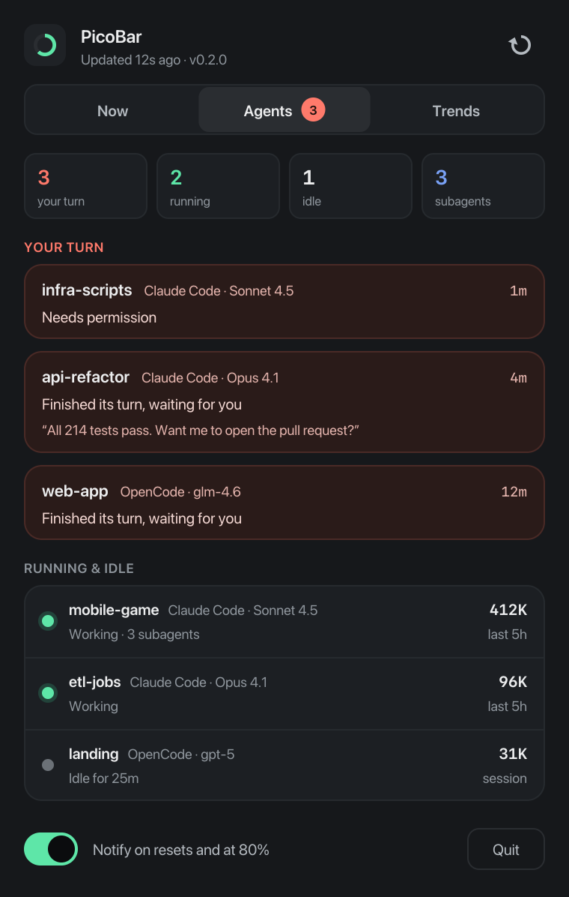
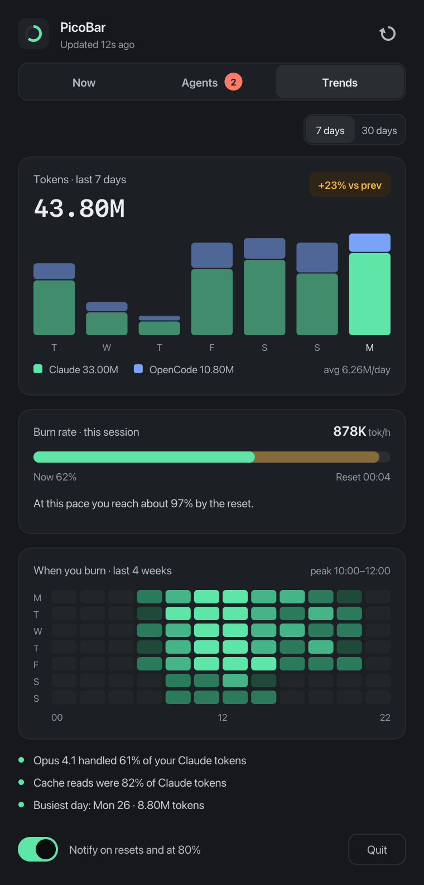
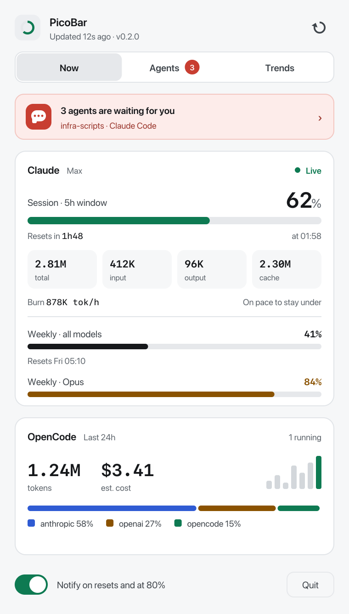
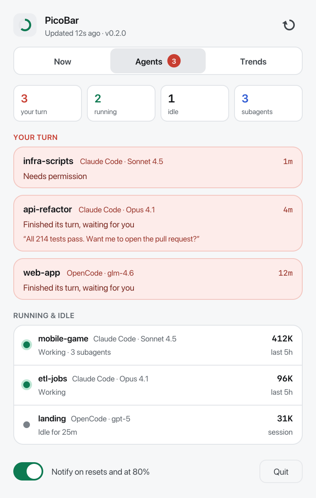
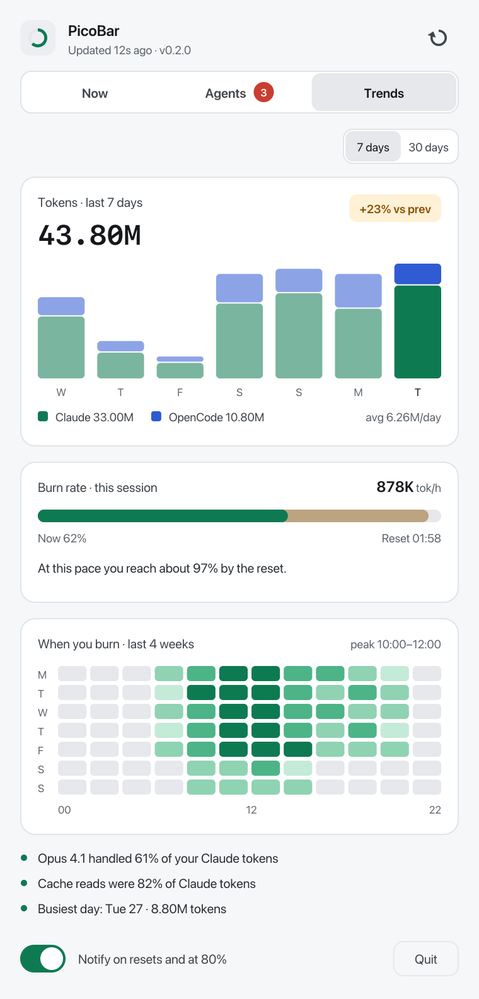

# PicoBar

**Ultra-light menu bar and tray monitor for Claude and OpenCode, on macOS, Windows and Linux.**

See your Claude limits at a glance, get notified when they reset, and know
which of your coding agents is waiting for you. Native Rust, no webview, no
runtime: a ~2 MB app that uses about 16 MB of memory and 0% CPU when idle.

<p align="center">
  
</p>

<table>
  <tr>
    <th>Now</th>
    <th>Agents</th>
    <th>Trends</th>
  </tr>
  <tr>
    <td></td>
    <td></td>
    <td></td>
  </tr>
  <tr>
    <td></td>
    <td></td>
    <td></td>
  </tr>
</table>

<sub>Screenshots use demo data (`picobar --render <dir> --demo`, add `--light` for the light theme).</sub>

## Features

**In the menu bar** — a ring gauge with your Claude 5-hour session usage. It
turns amber at 80%, and gets a coral dot when an agent is waiting for you.
Left click opens the popover; right click opens a compact menu.

**Now**
- Session usage with countdown and local time of the reset
- Token counter for the current session: total, input, output, cache
- Burn rate, and when you would hit the limit at this pace
- Weekly limits, per model when your plan has them
- OpenCode: tokens and estimated cost over 24 hours, last 7 days, providers

**Agents**
- Every Claude Code and OpenCode session active in the last hour
- Sessions that finished their turn and are waiting for you come first, with
  Claude's last message
- Running sessions with their subagents and token usage

**Trends**
- Tokens per day over 7 or 30 days (Claude and OpenCode), change vs the
  previous week
- Burn-rate projection for the current session
- Heatmap of when you use the most, over the last 4 weeks
- Insights: top model, cache share, busiest day

**Notifications** when your session or weekly limit resets, and when usage
crosses the warn threshold. Can be turned off from the popover or the menu.

**Settings** (in the right-click menu) — warn threshold (70, 80 or 90%),
how often limits are refreshed (3, 5, 10 or 15 min), what the menu bar shows
(percent, time to reset, or icon only; not on Windows), and launch at login.

## Install

Download the latest build from [Releases](https://github.com/lido772/picobar/releases).

**macOS 11+** (Intel and Apple Silicon) — `PicoBar-<version>-macos-universal.dmg`:
open it and drag PicoBar to Applications. The app is not notarized yet, so
macOS says it "could not verify PicoBar is free of malware" the first time.
Either open **System Settings › Privacy & Security** and click **Open Anyway**
next to PicoBar, or run once in Terminal:
`xattr -dr com.apple.quarantine /Applications/PicoBar.app`

**Windows 10+**
- Installer — `PicoBar-<version>-windows-x64-setup.exe`: installs for your
  user only (no admin rights), adds PicoBar to the Start menu and, if you
  want, starts it when you sign in.
- Portable — `PicoBar-<version>-windows-x64-portable.zip`: unzip anywhere (a
  USB stick works) and run `PicoBar.exe`. Settings stay in a `PicoBar Data`
  folder next to it; nothing is written to your profile.

**Linux** (x86_64 and arm64, GTK 3)
- Debian / Ubuntu — `picobar_<version>_amd64.deb` (Intel/AMD) or
  `picobar_<version>_arm64.deb` (ARM64):
  `sudo apt install ./picobar_<version>_<arch>.deb`
- Any distribution — `PicoBar-<version>-linux-x86_64.tar.gz` (Intel/AMD) or
  `PicoBar-<version>-linux-aarch64.tar.gz` (ARM64): unpack and run
  `./picobar`. Needs GTK 3 and `libayatana-appindicator3` (or
  `libappindicator3`).
- The icon lives in the system tray, which needs AppIndicator support (KDE,
  Xfce, Cinnamon, Ubuntu's GNOME; on stock GNOME install the AppIndicator
  extension). Without a tray, PicoBar opens as a small window; `picobar
  --window` does the same on purpose. The tray menu has **Open PicoBar**.

To start PicoBar at login, open the menu and choose **Settings › Launch at
login**. On Windows the installer option also works; Linux writes an entry to
`~/.config/autostart`.

## Updates

PicoBar checks GitHub for a new release once a day (one small request, no
data about you is sent). When one is out, the popover shows an **Update**
button and you get one notification. PicoBar then downloads the build for
your system, checks its SHA-256 against the release's `SHA256SUMS.txt`,
replaces itself and restarts. You can also use **Check for updates** in the
menu, or `picobar --update` in a terminal.

The Linux `.deb` installs system-wide, so PicoBar points you to the release
page instead; update it with `apt` like any package.

## Build from source

```sh
cargo build --release
./target/release/picobar                 # menu bar / tray app
./target/release/picobar --window        # open the popover as a window
./target/release/picobar --once          # print the current numbers and exit
./target/release/picobar --update        # update to the latest release
./target/release/picobar --render out    # draw the popover tabs to BMP files (--light for the light theme)
```

Linux needs `libgtk-3-dev` and `libayatana-appindicator3-dev` to build.

## Where the numbers come from

| What | Source |
|---|---|
| Session and weekly limits | The usage data Claude Code shows in `/usage`, fetched with your existing Claude Code login (macOS Keychain, or `~/.claude/.credentials.json`) every 3 minutes |
| Claude tokens, history and sessions | Claude Code's local logs in `~/.claude/projects/` (last 35 days, read incrementally) |
| OpenCode tokens, cost and sessions | OpenCode's local database (`~/.local/share/opencode/opencode.db`), read-only |

The limits data is not a public API and may change. If it is unavailable, or
your login has expired, PicoBar says so and keeps showing local data. Your
login token never leaves your machine except to authenticate that request, and
is never written to disk or logged. Everything else stays local.

## How it stays light

- No webview, no GPU stack: the popover is drawn by a small software painter
  and shown with [`softbuffer`](https://crates.io/crates/softbuffer).
- Text uses the fonts your OS already has (San Francisco, Segoe UI),
  memory-mapped instead of embedded.
- HTTPS, Keychain and notifications go through tools the OS ships (`curl`,
  `security`, `osascript`, PowerShell) instead of extra libraries.
- The app sleeps between refreshes and reads only the bytes appended to logs.

| Metric | Budget | macOS | Windows | Linux |
|---|---|---|---|---|
| Binary | ≤ 3 MB | 2.0 MB | 1.8 MB | 2.4 MB |
| Idle memory | ≤ 20 MB | 16 MB | – | 18.5 MB private (GTK) |
| Idle CPU | ~0 % | 0 % | – | 0 % |

Checked in CI by `scripts/size.sh`. History in [docs/SIZE.md](docs/SIZE.md).

## Roadmap

- Signed and notarized macOS builds, signed Windows builds

## License

MIT
